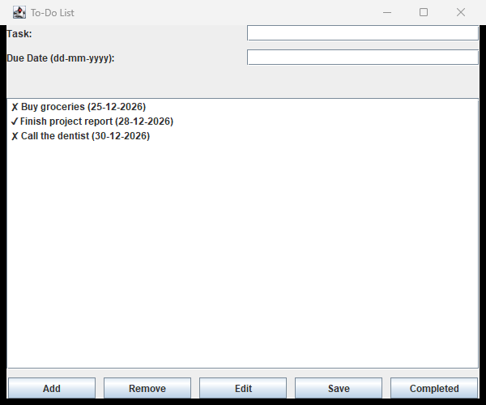

# 📝 Java To-Do List

**Java To-Do List** is a simple **task management desktop app** built with **Java Swing**. It lets you add tasks with a due date, mark them as completed, edit or remove them, and view everything in a single clean list — all in one window, with no external dependencies.

<p align="left">
  
  
  
</p>

## 📚 Table of Contents

- [Features](#-features)
- [Preview](#-preview)
- [Project Structure](#-project-structure)
- [Installation Guide](#️-installation-guide)
- [Technologies Used](#-technologies-used)
- [License](#-license)
- [Contributing](#-contributing)
- [Connect with Me](#-connect-with-me)

## ✨ Features

✅ **Add tasks:** Enter a task and a due date (`dd-mm-yyyy`) and add it to the list.
✅ **Edit tasks:** Update the task text or due date of any selected item.
✅ **Remove tasks:** Delete the selected task from the list.
✅ **Mark as completed:** Toggle a task's completed status, shown with a `✓`/`✗` marker.
✅ **Custom list rendering:** Tasks are displayed through a custom cell renderer.

## 👀 Preview



## 📂 Project Structure

```
java-todo-list/
├── src/
│   └── Main.java     # App window, task list, and all Swing UI logic
├── banner.png          # Screenshot used in this README
└── README.md
```

## ⚙️ Installation Guide 🛠️

### 1️⃣ Clone the Repository 📥
```bash
git clone https://github.com/Iqbolshoh/java-todo-list.git
```

### 2️⃣ Navigate to the Project Directory 📂
```bash
cd java-todo-list/src
```

### 3️⃣ Compile the Project 🧱
```bash
javac Main.java
```

### 4️⃣ Run the Application 🚀
```bash
java Main
```

## 🖥 Technologies Used


## 📜 License
This project is open-source and available under the [MIT License](./LICENSE).

## 🤝 Contributing
🎯 Contributions are welcome! If you have suggestions or want to enhance the project, feel free to fork the repository and submit a pull request.

## 📬 Connect with Me
💬 I love meeting new people and discussing tech, business, and creative ideas. Let's connect! You can reach me on these platforms:

<div align="center">

[](https://iqbolshoh.uz)
[](mailto:iilhomjonov777@gmail.com)
[](https://github.com/iqbolshoh)
[](https://t.me/+998776030033)
[](https://wa.me/998776030033)
[](https://instagram.com/iqbolshoh.dev)
[](https://www.youtube.com/@Iqbolshoh_dev)

</div>
